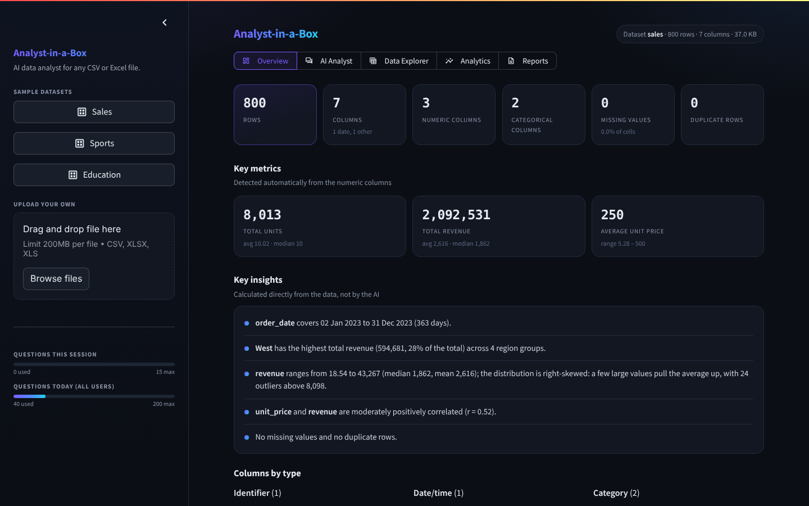
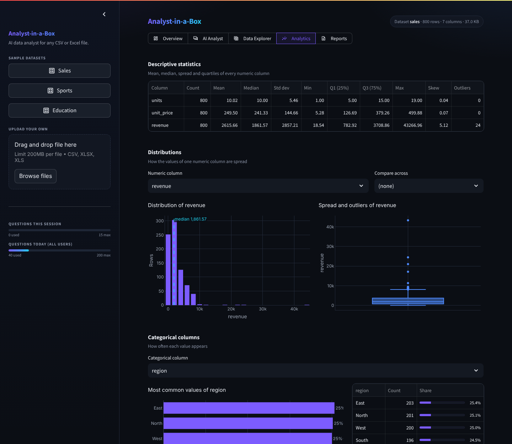
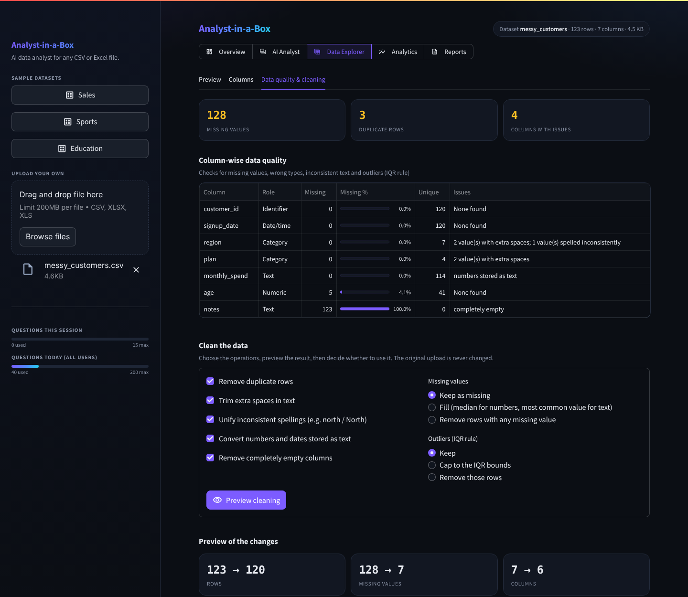
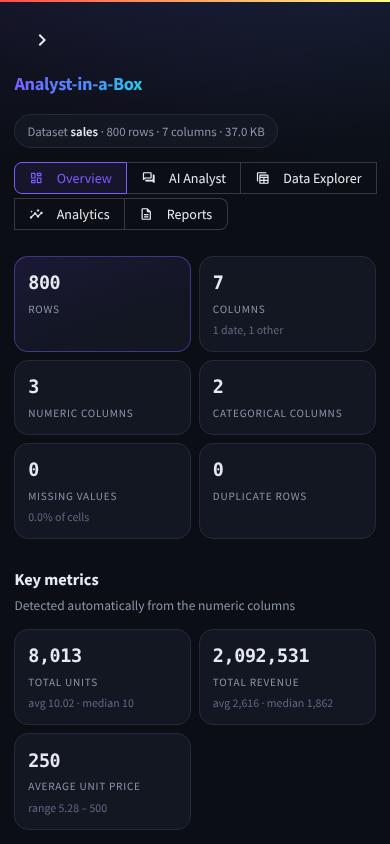
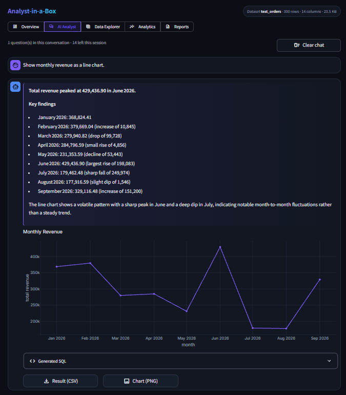

# Analyst-in-a-Box 📊

### AI-Powered Data Analytics Assistant

Turn CSV and Excel files into answers using natural language, SQL, statistics and interactive charts.

[](https://www.python.org/)
[](https://streamlit.io/)
[](https://pandas.pydata.org/)
[](https://plotly.com/python/)

**[🚀 Live Demo](https://analyst-in-a-box.streamlit.app/) | [💻 GitHub Repository](https://github.com/Sujal-tyagi17/Analyst-in-a-box)**

---

## 📌 Overview

Analyst-in-a-Box is an AI-powered data analytics application. Upload a CSV or Excel file (or pick a bundled sample) and it:

1. **Profiles the data automatically:** column types, key metrics, missing values, duplicates and data-computed insights.
2. **Checks and cleans data quality:** finds missing values, numbers stored as text, inconsistent spellings and outliers, and cleans them only when you choose to.
3. **Runs exploratory analysis:** descriptive statistics, distributions, frequencies, correlations, trends and outliers as interactive charts.
4. **Answers questions in English or Hindi:** an AI agent writes and runs its own read-only SQL, calculates statistics, draws charts and explains the result.
5. **Exports the work:** result tables, cleaned data, charts and a PDF analysis report.

Nothing is hardcoded to a domain. Column roles (measure, category, date, identifier) are detected from the data, so the same code works on sales, sports, student or any other tabular data.

---

## 🖼️ Screenshots

| Overview dashboard | Analytics (EDA) |
|---|---|
|  |  |

| Data quality & cleaning | Mobile |
|---|---|
|  |  |

| AI Analyst (live app, Groq) |
|---|
|  |

---

## ✨ Features

### 1. Overview dashboard
- Rows, columns, numeric / categorical / date columns, missing values, duplicate rows and file size.
- **Key metrics** chosen from the data: totals for additive columns (revenue, units), averages for prices, scores and percentages. Constant columns and IDs are skipped.
- **Key insights calculated with pandas, not the AI**: date range, top group and its share, distribution and skew, strongest correlation, data quality.

### 2. AI Analyst
- Ask questions in **English or Hindi**; follow-up questions reuse the earlier SQL ("now break that down by category").
- The agent chains its tools as needed: `run_sql` → `run_analysis` → `make_chart`.
- Structured answers: a direct answer, key findings with figures, and a plain-language conclusion.
- The prompt requires every number to come from a query result, and says when the data can't answer a question (e.g. profit with no cost column).
- **Suggested questions** generated from the dataset's own column names.
- **Live progress** of the real steps: understanding the question, generated SQL, executing the query, statistical analysis, preparing the chart.
- Statistics explained in plain language (r, p-values, R², IQR bounds) with the generated SQL in an expandable section.
- Clear chat (keeps the dataset), recent questions and a session query history.

### 3. Data Explorer, data quality & cleaning
- Data preview and column details (detected role, SQL type, missing %, unique values, examples).
- Column-wise quality checks: missing values, numbers or dates stored as text, extra spaces, inconsistent spellings, constant or empty columns, IQR outliers.
- **Opt-in cleaning with preview**: remove duplicates, trim spaces, unify spellings, convert types, drop empty columns, fill or drop missing values, cap or remove outliers.
- Every change is listed before you apply it. **The original upload is never modified**; you can switch back at any time.

### 4. Analytics (automated EDA)
- Descriptive statistics: mean, median, standard deviation, quartiles, skew and outlier count.
- Histograms and box plots (optionally split by a category), categorical frequencies.
- Correlation heatmap, strongest pairs and scatter plots with a linear fit.
- Trend over time when a date column exists, and an outlier table.
- Charts appear only when the data supports them.

### 5. Interactive visualizations
- Plotly charts in a consistent dark theme with hover values and PNG download: bar, line, scatter, histogram, box and heatmap.
- Charts requested by the AI are redrawn interactively; Matplotlib is kept for print-friendly charts in the PDF report.

### 6. Reports & exports
- **PDF analysis report**: dataset overview, key metrics, findings, charts, and each AI question with its answer, chart and SQL.
- CSV downloads: each AI answer's query result, the current (original or cleaned) data, and the query history.
- PNG downloads for every chart.

### 7. Safety & reliability
- **Read-only SQL**: one `SELECT`/`WITH` statement only, write/DDL keyword blocklist, read-only connection, automatic `LIMIT`, query timeout.
- **Provider fallback**: Groq first, Gemini if it fails (configurable); providers without a key are skipped.
- **Answer cache** with a per-question lock: duplicate requests wait for the first answer instead of calling the AI again; failed answers are not cached.
- **Usage limits**: per-session and per-day question caps.
- **Friendly errors**: raw API errors and stack traces are logged, never shown; upload errors explain what is wrong with the file.
- File handling: UTF-8 and Windows/Excel (cp1252) CSV encodings, binary and empty files rejected with a clear message.

---

## 🛠️ Tech Stack

| Category | Technologies |
|---|---|
| Language | Python 3.11 |
| Frontend | Streamlit, custom CSS |
| Data processing | Pandas, NumPy |
| Database | SQLite, SQLAlchemy |
| Statistics | SciPy, Statsmodels |
| Visualization | Plotly (interactive), Matplotlib (report charts) |
| Reporting | fpdf2 |
| AI integration | Groq, Google Gemini (Anthropic and OpenAI also supported) |
| Testing | pytest, evaluation harness |

---

## 🏗️ Architecture

```
            ┌────────────────────────── app.py (Streamlit UI) ──────────────────────────┐
            │  Overview · AI Analyst · Data Explorer · Analytics · Reports              │
            └──────┬───────────────────────────┬───────────────────────────┬────────────┘
                   │                           │                           │
   upload ──▶ agent/schema_reader.py     agent/orchestrator.py        analytics/
             file → SQLite + schema      tool-calling agent loop      profiling.py  dashboard + insights
                   │                     (Groq → Gemini fallback)     cleaning.py   quality + cleaning
                   │                           │                      eda.py        EDA tables + charts
                   ▼                           ▼                      charts.py     Plotly theme
              SQLite (read-only) ◀──── agent/tools.py                 report.py     PDF report
                                       run_sql · run_analysis · make_chart
```

### Workflow
1. A dataset is loaded into SQLite and its schema is summarised.
2. The profiling, cleaning and EDA modules work directly on the data with pandas; no AI involved.
3. For a question, the agent receives only the schema summary, decides which tools to call, and every SQL query is validated and run read-only.
4. Statistics and charts are computed from the query results, then the AI writes the answer from those results.

The AI never sees hardcoded table or column names. The schema summary built at load time is its only dataset context.

---

## 🚀 Getting Started

### Prerequisites
- Python 3.11
- Git
- A Groq API key (free at [console.groq.com/keys](https://console.groq.com/keys))
- A Gemini API key (optional backup, free at [aistudio.google.com/apikey](https://aistudio.google.com/apikey))

### 1. Clone the repository
```bash
git clone https://github.com/Sujal-tyagi17/Analyst-in-a-box.git
cd Analyst-in-a-box
```

### 2. Create a virtual environment
```bash
python -m venv venv
```
Activate it. **Windows:** `venv\Scripts\activate` · **macOS / Linux:** `source venv/bin/activate`

### 3. Install dependencies
```bash
pip install -r requirements.txt
```

### 4. Configure environment variables
Copy `.env.example` to `.env` and fill in your keys (`.env` is gitignored):

```env
LLM_PROVIDER=groq
LLM_FALLBACK=groq,gemini
GROQ_API_KEY=your_groq_api_key
GEMINI_API_KEY=your_gemini_api_key
```

| Variable | Required | Default | Purpose |
|---|---|---|---|
| `LLM_PROVIDER` | Yes | `groq` | Provider tried first |
| `LLM_FALLBACK` | No | `groq,gemini` | Backup order if a provider fails |
| `GROQ_API_KEY` | Yes* | – | Groq key |
| `GEMINI_API_KEY` | No | – | Gemini key (backup) |
| `GROQ_MODEL` / `GEMINI_MODEL` | No | `openai/gpt-oss-120b` / `gemini-3.6-flash` | Model overrides |
| `MAX_SESSION_QUESTIONS` | No | `15` | Questions per browser session |
| `MAX_DAILY_QUESTIONS` | No | `200` | Questions per day across all users |
| `AGENT_MAX_STEPS` / `LLM_TIMEOUT_S` | No | `8` / `60` | Agent loop length and per-call timeout |

\* At least one provider key is needed for the AI Analyst. The dashboard, data quality, analytics and exports work without any key.

On **Streamlit Community Cloud**, put the same keys in the app's **Secrets** panel in TOML format (`GROQ_API_KEY = "..."`).

### 5. Run the application
```bash
streamlit run app.py
```
Open the local URL that Streamlit prints.

Docker is also supported: `docker compose up --build` (reads the same variables from `.env`).

---

## 🧪 Testing & Evaluation

### Unit tests
```bash
python -m pytest eval/
```
**53 tests**, covering:
- read-only SQL rejection, auto-limit and truncation warnings;
- column-role detection, metrics and insights (checked against pandas);
- cleaning (never modifies the original, logs every change, never invents IDs or dates);
- EDA charts for every sample dataset;
- file loading (Excel vs CSV, cp1252, empty and binary files);
- provider fallback, error messages, the answer cache and answer formatting;
- the PDF report.

All 53 passed on Python 3.11 (31 Oct 2026).

### Evaluation harness
The harness asks **18 questions across the 3 sample datasets** and checks each answer against an independent SQL query run directly on the data.

```bash
python -m eval.run_eval                   # real LLM (needs an API key)
python -m eval.run_eval --provider mock   # offline, no API cost
python -m eval.run_eval --limit 3         # quick check
```

| Run | Result | Date |
|---|---:|---|
| Real LLM: Groq `openai/gpt-oss-120b` (current version) | **17/18 (94%)**: Sales 6/6, Sports 6/6, Education 5/6 | 31 Oct 2026 |
| Real LLM: Groq `openai/gpt-oss-120b` (earlier version) | 16/18 (89%) | before 31 Oct 2026 |
| Offline mock planner (no API) | 17/18 (94%) | 31 Oct 2026 |

The one miss is a strict-checker case, not a wrong answer: for *"Do male and female students differ in average exam score?"* the model compared the group averages with plain SQL, while the checker expects the dedicated `group_compare` statistical test. The mock planner is a deliberately simple keyword planner used to test the pipeline without API cost; it is not a measure of answer quality.

A manual test on an unseen 300-order e-commerce dataset (totals, top groups, follow-ups, return rates, a line chart, correlation, a Hindi question, refusing to delete data, and saying when profit can't be calculated) passed 12/12 on the live app; after the update, the totals, follow-up, line chart, Hindi, answer-cache and PDF checks were repeated on the live app and passed.

---

## 📂 Project Structure

```text
Analyst-in-a-Box/
├── app.py                    # Streamlit UI: Overview, AI Analyst, Data Explorer, Analytics, Reports
├── agent/
│   ├── orchestrator.py       # tool-calling agent loop, provider fallback, progress events
│   ├── tools.py              # run_sql (read-only), run_analysis, make_chart
│   ├── schema_reader.py      # file → SQLite, encoding handling, schema summary
│   ├── prompts.py            # system prompt + tool definitions
│   ├── answer_cache.py       # thread-safe answer cache with per-question locks
│   ├── usage.py              # daily question counter
│   └── ui.py                 # CSS + small HTML components
├── analytics/
│   ├── profiling.py          # column roles, key metrics, insights, suggested questions
│   ├── cleaning.py           # quality report + opt-in cleaning
│   ├── eda.py                # EDA tables and Plotly figures
│   ├── charts.py             # shared Plotly theme, AI chart rendering
│   └── report.py             # PDF analysis report
├── eval/
│   ├── run_eval.py           # 18-question evaluation harness
│   ├── test_questions.json
│   ├── test_tools.py         # SQL tool tests
│   ├── test_analytics.py     # profiling, cleaning, EDA, loading, PDF tests
│   └── test_agent.py         # agent, fallback, errors, SQL safety, cache tests
├── data/sample_datasets/     # sales.csv, sports.csv, education.csv
├── docs/screenshots/
├── .streamlit/               # theme config + secrets.toml.example
├── requirements.txt
├── Dockerfile / docker-compose.yml
├── .env.example
└── README.md
```

---

## ⚠️ Current Limitations

- One table per session: multi-file joins are not supported.
- AI answers depend on the provider's free-tier quota (Gemini's free tier for the default model allows about 20 requests a day; each question uses 3–4).
- Hindi questions and answers work in the app, but Hindi text can't be displayed in the PDF report yet (the bundled font has no Devanagari).
- The daily usage counter is stored locally and resets when the app restarts.
- No user accounts or saved history: a session's chat and history are lost on reload.
- Column roles are detected heuristically; an unusual column may get the wrong role (e.g. a numeric code treated as a measure).

---

## 🔮 Future Improvements

- Multiple files and joins, and a direct PostgreSQL connection.
- Hindi font support in the PDF report.
- Extend the evaluation harness with the 300-order test set, and make the group-comparison check accept a correct SQL comparison.
- Let users correct a column's detected role.
- Saved sessions and shareable report links.

---

## 🌐 Live Application

**https://analyst-in-a-box.streamlit.app/**

---

## 👨‍💻 Author & Maintainer

**Sujal Tyagi** · [GitHub Profile](https://github.com/Sujal-tyagi17)

---

*Built with Python, SQL, data analytics and AI to make working with data simpler and more accessible.*
